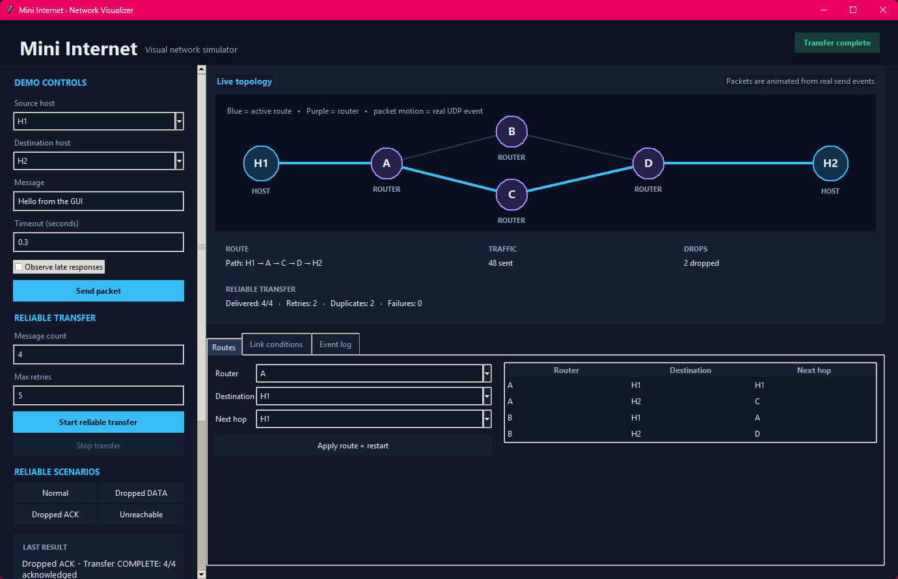

# Mini Internet: Track B Reliable Transfer

   

A small Python network simulator where hosts and routers exchange real UDP packets on your computer, with a GUI for watching reliable (stop-and-wait) transfer recover from lost packets.

CSCI 5500 Computer Networks, Fall 2026 - Group 13.



## Run the GUI

```bash
python gui.py
```

Use `python3 gui.py` if `python` is not found. Run it from the repository root. Only Python 3 is needed (Tkinter comes with it on Windows and macOS; some Linux systems need `python3-tk`).

> **Warning:** do not run `main.py --all` at the same time as the GUI. Both use the same UDP ports.

## Use the GUI

1. Choose a **Source host** and a **Destination host** (they must differ).
2. Click **Send packet** for best-effort delivery: one message, sent once, with no recovery.
3. Click **Start reliable transfer** for Track B: the messages are sent with acknowledgements and retransmission.
4. Set **Message count**, **Timeout (seconds)**, and **Max retries** first.
5. Try the scenarios **Normal**, **Dropped DATA**, **Dropped ACK**, and **Unreachable**.
6. Watch the topology and animations, the counters (Delivered, Retries, Duplicates, Failures), and the **Event log** tab.

Something not working? See the [GUI manual](info/GUI.md) for every control and a troubleshooting table.

## Track B: Reliable Transfer

This project chose **reliable transfer** (not routing or congestion control). It sends a finite, numbered sequence of messages over lossy UDP links, and implements:

- stop-and-wait: one unacknowledged message at a time;
- ACKs, sequence numbers, run IDs, a timeout, and retransmission;
- ordered, duplicate-free delivery at the receiver;
- re-ACKing duplicates, so a lost ACK does not stall the sender;
- bounded retries: the transfer fails cleanly when they run out;
- best-effort mode as the comparison baseline.

**Evidence**

| Required evidence | Where to see it |
|---|---|
| Loss-free ordered delivery | `test_messages_are_delivered_exactly_once_and_in_order` in [tests/test_reliable_ordered_delivery.py](tests/test_reliable_ordered_delivery.py); GUI scenario **Normal** |
| Dropped-data recovery | `test_dropped_data_packet_is_retransmitted_and_delivered_once` in the same file; GUI scenario **Dropped DATA** |
| Dropped-ACK recovery | `test_dropped_final_ack_is_reacked_for_duplicate_data` in the same file; GUI scenario **Dropped ACK** |
| Unreachable-destination failure | `test_unreachable_destination_fails_after_bounded_retries` in the same file; GUI scenario **Unreachable** |
| Protocol rules (ACK matching, sequence handling, timeout and retry) | [tests/test_protocol.py](tests/test_protocol.py) |
| Best-effort vs reliable at 0% and 5% loss, three seeds | [results/evaluation_report.md](results/evaluation_report.md) |

Run all the tests with `python -m unittest discover -s tests`.

## More details

- [GUI manual](info/GUI.md): controls, scenarios, counters, animations, troubleshooting
- [Command-line use](info/CLI.md): `main.py`, probes, link conditions, logs
- [Host](info/HOST.md), [Packet](info/PACKET.md), and [Routers](info/ROUTERS.md) design notes
- [Evaluation report](results/evaluation_report.md): results and interpretation
