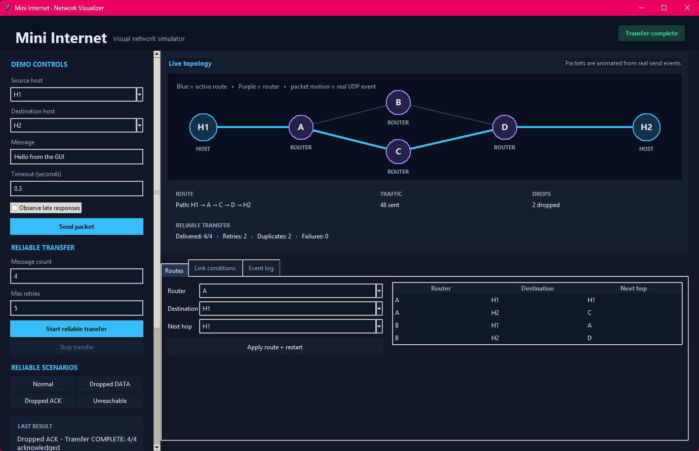

# GUI manual

The GUI is a visual demo of the Mini Internet. It runs the same `Host`, `Router`, UDP, routing, packet validation, loss, and delay code as the command line, so what you see is real traffic, not an animation of a model.



## Requirements and launch

- Python 3. No third-party packages are needed.
- Tkinter, which ships with Python on Windows and macOS. On some Linux distributions install the system package `python3-tk`.
- Run from the repository root:

```bash
python gui.py
```

Use `python3 gui.py` if `python` is not available. The window sizes itself for your screen and redraws the map to fit. The left control panel scrolls (mouse wheel or scroll bar) when the window is short.

## What starts automatically

When the window opens it starts a network in the background, in this process:

- routers `A`, `B`, `C`, and `D`;
- the destination host (default `H2`) as an echo server;
- the source host (default `H1`), which is kept free for your probes.

It uses the UDP addresses in `data/network.json` and the routes in `data/routes.json` on localhost. The status badge (top right) shows **Network running** when it is ready.

All edits you make in the GUI (routes, conditions, scenarios) are kept **in memory**. The JSON files are never modified, and **Reset all settings** restores what was loaded at startup.

> **Do not run the GUI at the same time as `main.py --all`** (or any `main.py` device). They use the same ports, so the second one cannot start.

## The window at a glance

| Area | What it shows |
|---|---|
| **DEMO CONTROLS** (left) | Source and destination, message, timeout, send button |
| **RELIABLE TRANSFER** (left) | Message count, max retries, start and stop |
| **RELIABLE SCENARIOS** (left) | Normal, Dropped DATA, Dropped ACK, Unreachable |
| **LAST RESULT** (left) | The outcome of the latest probe or transfer |
| **QUICK SCENARIOS** (left, scroll down) | Best-effort demos: Normal delivery, Force a route drop, Show a late response |
| **Live topology** (top) | Hosts (blue circles), routers (purple), links, and moving packets. The bright blue line is the active route. |
| **ROUTE / TRAFFIC / DROPS** | Path, packets sent, packets dropped |
| **RELIABLE TRANSFER** tile | Delivered, retries, duplicates, failures |
| **Tabs** (bottom) | **Routes**, **Link conditions**, **Event log** |
| Status badge (top right) | Short state, such as **Network running** or **Transfer complete** |
| Footer (left, bottom) | The active path and the current run id |

## Choosing the endpoints

Use **Source host** and **Destination host**. They must be different, or you will get an **Invalid endpoints** message. Changing either one redraws the map and shows "Endpoint change ready - network restarts on send": the network restarts for the new endpoints the next time you send.

## Best-effort probe: Send packet

Best effort means each message is sent once. If it is lost, nothing re-sends it.

1. Type a **Message** (it cannot be empty).
2. Set **Timeout (seconds)**: how long to wait for the echo. It must be a positive number.
3. Click **Send packet**. The status badge shows **Probe in flight**, then the result appears under **LAST RESULT**:

| Result | Meaning |
|---|---|
| `MATCHED response: '...'` | The destination echoed your message back in time. |
| `TIMEOUT for '...'` | No matching echo arrived before the timeout (the packet or its echo was lost or delayed). |
| `LATE response: '...'` | The matching echo arrived after the timeout (only with **Observe late responses** ticked; it still counts as a timeout). |
| `ERROR: ...` | The probe could not run; the text says why. |

**Observe late responses** keeps listening for 3 seconds after a timeout so a delayed echo can be reported as LATE.

## Reliable transfer

Reliable transfer sends several messages with stop-and-wait: each message is acknowledged (ACK) before the next is sent, and a lost one is re-sent after the timeout, up to a limit.

1. Type a **Message**. The same text is sent **Message count** times.
2. **Message count**: a whole number from 1 to 100.
3. **Timeout (seconds)**: the same field used by probes. Here it is the wait before a retransmission.
4. **Max retries**: a whole number, 0 or more. Retransmissions allowed per packet.
5. Click **Start reliable transfer**. It starts a fresh reliable network, sends the messages in the background (the window stays responsive), and finishes with one of:
   - `Transfer COMPLETE: n/n acknowledged`
   - `Transfer FAILED: k/n acknowledged` (retries ran out)
   - `ERROR: ...`
6. **Stop transfer** (enabled only while running) stops the transfer and the network. The next send starts a fresh best-effort network.

While a transfer runs, the other controls are disabled and restored when it finishes.

If a value is not valid you get an **Invalid transfer settings** message that names the field (for example "Message count must be between 1 and 100", "Timeout must be a positive number", "Max retries must be zero or more", or an oversized message).

## Reliable scenarios

Each button builds a ready-made, reproducible reliable transfer from the original configuration, fills in the count, timeout, and retries, then runs it. The settings (conditions or routes) are visible afterwards in **Link conditions** and **Routes**.

| Button | What it does | Settings | Expected result |
|---|---|---|---|
| **Normal** | Restores normal conditions and routes, then transfers. | 4 messages, 0.3 s timeout, 5 retries | COMPLETE, no retries |
| **Dropped DATA** | 40% seeded loss on the source's first link, so some DATA packets vanish. | same, loss seed 1 | COMPLETE after 2 retries |
| **Dropped ACK** | 40% seeded loss on the destination's first link, so some ACKs vanish; the sender re-sends and the receiver sees duplicates. | same, loss seed 2 | COMPLETE after 2 retries, 2 duplicates |
| **Unreachable** | The source's first router forgets the route to the destination. | 3 messages, 0.3 s timeout, 2 retries | FAILED after the retries run out (labelled "expected FAILED") |

The loss patterns use fixed seeds, so the same scenario gives the same counters each time (timings can differ slightly). Scenarios are ignored while a probe or transfer is running. Use **Normal** or **Reset all settings** to clear a scenario.

## Best-effort quick scenarios

Further down the left panel:

- **Normal delivery**: clears all link conditions, unticks **Observe late responses**, and restarts.
- **Force a route drop**: 100% loss on the first router's next link along the current path. Send a packet to see a drop and a TIMEOUT.
- **Show a late response**: ticks **Observe late responses** and adds a 4000 ms delay on the destination's first link. Send a packet with a timeout shorter than 4 seconds to see TIMEOUT followed by LATE.

## Reading the display

**Status badge and LAST RESULT.** The badge gives the current state: Network running, Probe in flight, Packet matched, Probe timed out, Late response observed, Reliable transfer running, Transfer complete, Transfer failed, Transfer stopped. Green means success, amber a warning (timeout, late, stopped), red an error or failure. The scenario name prefixes the result when you ran a scenario.

**Counters.**

| Counter | Counts |
|---|---|
| **TRAFFIC** | Every packet actually sent on any link (one packet crossing three links counts three) |
| **DROPS** | Packets dropped by injected loss or by a router (no route, hop limit, and so on) |
| **Delivered n/total** | Distinct DATA messages the destination accepted. Duplicates are not counted twice. |
| **Retries** | Retransmissions by the sender |
| **Duplicates** | DATA or FIN the receiver had already seen (it re-ACKs them) |
| **Failures** | Packets that ran out of retries |

The reliable counters reset when a new transfer or scenario starts and keep their values afterwards.

**Animations.** Every moving dot is a real packet event, drawn on one link at a time (packets on the same link queue behind each other, different links move independently).

| Look | Meaning |
|---|---|
| Blue dot | DATA |
| Pink dot | ACK |
| Green dot | Other packets (for example FIN, or an echo) |
| Orange dot with a red outline | A retransmission |
| Extra double ring around the dot | A duplicate ACK |
| Small number above the dot | The sequence number |
| Amber dot in the middle of a link | A delayed packet (shown briefly) |
| Red flash on a link | A dropped packet |
| Red outline on a device | A drop with no link (for example no route) |

If a burst creates more animations than can be shown, the oldest animations are skipped; the Event log and counters still show everything.

**Event log tab.** One line per event with a time, the device, the event name, the packet fields, and the reason for drops (`injected_loss`, `no_route`, and so on). **Clear log** empties the view (the oldest lines also scroll away automatically).

## Routes and link conditions

**Routes tab.** Choose a **Router**, a **Destination**, and a **Next hop** (it must be adjacent to the router, or you will see **Invalid next hop**), then click **Apply route + restart**. The table lists every route.

**Link conditions tab.** Choose a directed link with **From** and **To**, set **Loss (0–1)**, **Delay (ms)**, and **Seed**, and click **Add / update**. **Remove selected** deletes the highlighted row. Changes take effect when you click **Apply conditions + restart** (or any restart). A rule affects one direction only; add a second rule for the reverse direction. Invalid values give **Invalid condition** or **Invalid link**.

## Restarting and resetting

- **Restart network**: stops everything and starts a fresh best-effort network with your current in-memory settings and endpoints. It is refused while a probe or transfer is running.
- **Reset all settings**: restores the routes and conditions loaded at startup (and clears **Observe late responses**), then restarts. Refused while a probe is running.
- Closing the window stops the network cleanly. If something is running you are asked to confirm.

## Troubleshooting

| Problem | What to do |
|---|---|
| **Could not start network** (or the status says **Network failed to start**) | Another copy of the GUI or a `main.py` device is using the ports. Close it, then click **Restart network**. |
| GUI and `main.py --all` together | Not supported. Stop one of them. |
| `No module named tkinter` | Install Tkinter (`python3-tk` on some Linux distributions). |
| **Invalid endpoints** | Source and destination must differ. |
| **Probe in progress** / **Transfer in progress** | Wait for it to finish, or click **Stop transfer**. |
| **Invalid timeout** / **Message required** | Use a positive timeout and a non-empty message. |
| **Scenario unavailable** | Source and destination are the same host, or a host has no link. Choose two different hosts. |
| **No router path** (from **Force a route drop**) | The selected endpoints have no usable route. Check the Routes tab or click **Reset all settings**. |
| Everything times out after you edited routes or conditions | Click **Reset all settings**. |
| Buttons below **RELIABLE SCENARIOS** are not visible | Scroll the left panel. |
| The window is slow after a very long transfer | Click **Clear log**. |

For command-line use (individual devices, one-shot probes, editing `data/network.json`), see [CLI.md](CLI.md). For the packet format and device behaviour see [PACKET.md](PACKET.md), [HOST.md](HOST.md), and [ROUTERS.md](ROUTERS.md). Measured results are in the [evaluation report](../results/evaluation_report.md).
