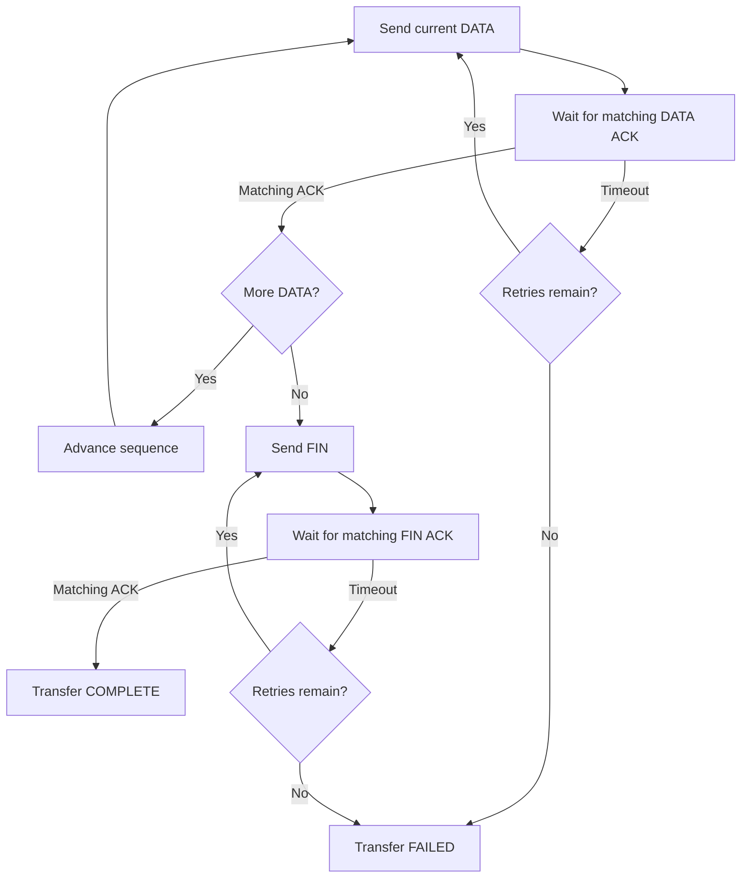
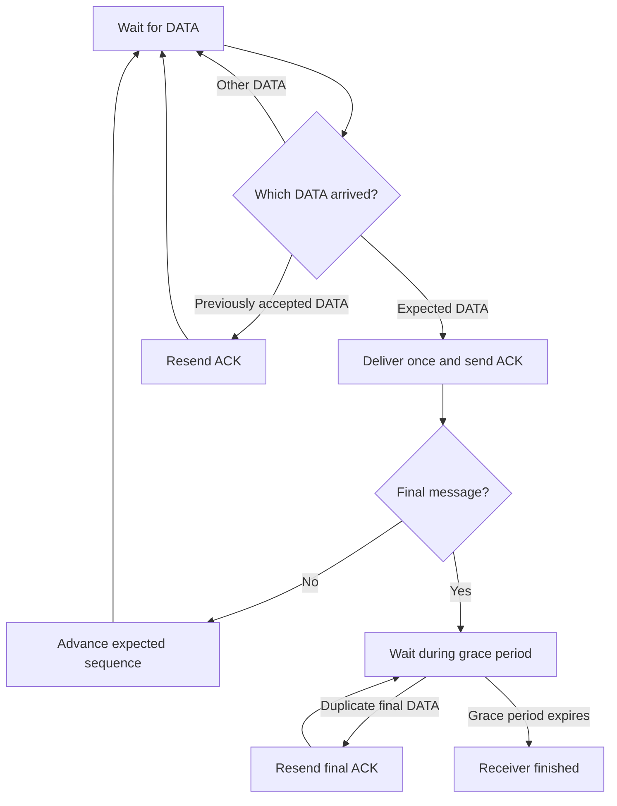

# Mini Internet Packet Format
## Overview

This document defines the packet format used by the Mini Internet hosts and routers.
Packets are serialized as JSON and encoded as UTF-8 before being transmitted using UDP.
The complete serialized packet must not exceed 1,200 bytes.
Each packet contains six required fields:

- `src`
- `dst`
- `hop_limit`
- `type`
- `id`
- `payload`

## Packet Structure

A packet is represented as a JSON object containing exactly six fields.

```json
{
  "src": "H1",
  "dst": "H2",
  "hop_limit": 8,
  "type": "DATA",
  "id": 0,
  "payload": "Hello H2"
}
```

## Fields

### `src`
The virtual address of the device that originally created the packet.
- Type: string
- Example: `"H1"`
- The source address does not change when the packet is forwarded.

### `dst`
The virtual address of the packet's final destination.
- Type: string
- Example: `"H2"`
- The destination address does not change when the packet is forwarded.
- Routers use the destination address to select the next hop.

### `hop_limit`
The number of forwarding hops remaining for the packet.
- Type: integer
- Valid range: `1–8`
- The value is decreased when a router forwards the packet.
- A packet whose hop limit has expired is discarded.

### `type`
Identifies the type of message carried by the packet.
- Type: string
- Supported values:
  - `DATA` — an ordinary application message.
  - `RESPONSE` — a response to an earlier message.
- Additional types may be added if required by the project extension.

### `id`
Identifies the message so it can be tracked across the network.
- Type: unsigned 32-bit integer
- Valid range: `0–4,294,967,295`
- Used to correlate messages and log records.
- Does not provide reliable delivery by itself.

### `payload`
Contains the application message carried by the packet.
- Type: string
- Contains the short message being sent between hosts.
- The payload must fit within the overall 1,200-byte packet limit.

## Encoding
Packets are serialized as JSON and encoded as UTF-8 before being transmitted through UDP.
Received UDP data is decoded from UTF-8 and parsed as JSON before the packet is validated.

## Size Limit
The complete serialized packet must not exceed 1,200 bytes.
The limit includes the JSON structure, field names, field values, and payload after UTF-8 encoding.

## Validation
A packet is invalid if:
- It is not valid UTF-8.
- It is not valid JSON.
- It is not a JSON object.
- A required field is missing.
- An unexpected field is present.
- A field has the wrong type.
- `hop_limit` is outside the range `1–8`.
- `type` is not a supported message type.
- `id` is outside the unsigned 32-bit range.
- The serialized packet exceeds 1,200 bytes.
Invalid packets must be rejected without crashing the host or router process.

## Example
A valid packet:
```json
{
  "src": "H1",
  "dst": "H2",
  "hop_limit": 8,
  "type": "DATA",
  "id": 0,
  "payload": "Hello H2"
}
```
When a router forwards the packet, the `hop_limit` is decreased. The other fields remain unchanged.
```json
{
  "src": "H1",
  "dst": "H2",
  "hop_limit": 7,
  "type": "DATA",
  "id": 0,
  "payload": "Hello H2"
}
```

## Error Handling
Invalid packets must be rejected without crashing the host or router process.
The receiver should record an error in its log when a packet is rejected.


## Track B packet format (draft)

This section follows the packet format in `feat/protocol_and_architecture`
at commit `557ce9c`. The baseline format above describes `main`.

| Field | DATA | ACK |
| --- | --- | --- |
| `src` | Virtual address of the sender | Virtual address of the receiver sending the acknowledgment |
| `dst` | Virtual address of the receiver | Virtual address of the original sender |
| `ttl` | Remaining forwarding hop limit | Remaining forwarding hop limit for the return path |
| `type` | `DATA` | `ACK` |
| `id` | Transfer identifier | Same `id` as the DATA being acknowledged |
| `seq` | Sequence value for this DATA packet | Same `seq` as the DATA being acknowledged |
| `payload` | Application message | Empty string (`""`) |

The draft Track B packet validator requires `ttl` to be an integer
from 1 to 8. Both `id` and `seq` are unsigned 32-bit integers.
ACK packets must carry an empty string as the payload. The full
UTF-8 JSON packet is limited to 1,200 bytes.

### Verified reliable transfer behavior

Verified against commit `b8e2379`. All 294 tests passed on macOS
with Python 3.14.10 after installing Homebrew's `python-tk@3.14`.

- Packets contain `src`, `dst`, `ttl`, `type`, `id`, `seq`, and `payload`.
- DATA sequence numbers start at 0 and increase by one per message.
- All packets in one transfer share the same transfer ID.
- After all DATA packets are acknowledged, the sender sends FIN with
  `seq` equal to the number of messages and an empty payload.
- Transfer completion requires an ACK for FIN.
- An ACK matches when its source and destination reverse the outgoing
  packet's endpoints and its ID and sequence number match.
- The default timeout is 1 second. The default retry limit permits
  three retransmissions per DATA or FIN packet.
- Exhausting the retry limit marks the transfer FAILED.
- The receiver accepts expected DATA, advances the expected sequence,
  and acknowledges it. Previously accepted DATA is acknowledged again.
  Future sequence numbers are dropped as out of order.
- An accepted FIN starts the receiver grace period. Its default duration
  is timeout × (max retries + 1), which is 4 seconds with default settings.
- Duplicate DATA and FIN packets are acknowledged during the grace period.
  Duplicate FIN packets do not extend the grace deadline.

### Sender state machine

Verified against `Host.start_transfer` and `Host._send_reliably`
at commit `b8e2379`. The sender waits for an ACK for each DATA packet,
then sends FIN and waits for its ACK.



Each retry resends the same packet and restarts its timeout.
The retry counter resets for each new DATA packet and for FIN.
ACKs that do not match leave the sender waiting until the current
deadline.

### Receiver state machine (draft)

The receiver delivers expected DATA once and sends an ACK. If the sender
retransmits a DATA packet that was already delivered, the receiver resends
its ACK and leaves the delivered message count unchanged.



This diagram describes the planned behavior. Verify how the integrated
receiver identifies the final message and handles the grace-period timer.

