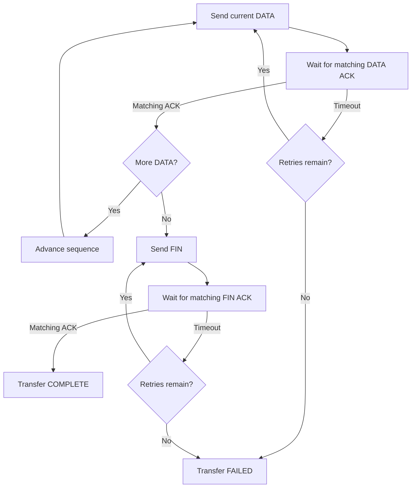
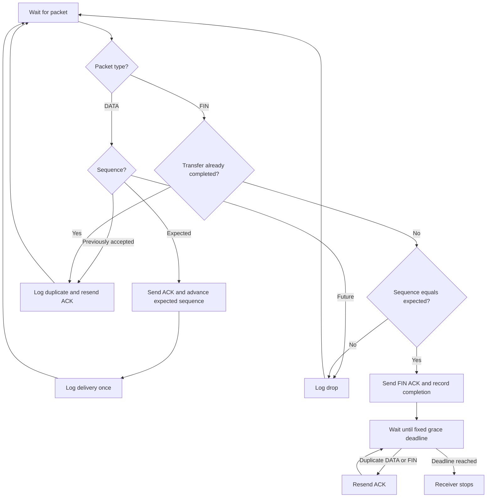

# Mini Internet Packet Format

This document describes the current Track B packet format and reliable
transfer behavior verified against commit `b8e2379`.

All 294 tests passed on macOS with Python 3.14.10 after installing
Homebrew's `python-tk@3.14`.

## Encoding and size limit

Packets are serialized as JSON, encoded as UTF-8, and transmitted over UDP.
The complete serialized packet must fit within 1,200 bytes, including
field names, values, JSON structure, and payload.

Received datagrams are decoded, parsed, and validated before processing.
Invalid packets are rejected and logged.

## Current packet structure

Every packet contains exactly seven fields:

- `src`
- `dst`
- `ttl`
- `type`
- `id`
- `seq`
- `payload`

Supported packet types are `DATA`, `RESPONSE`, `ACK`, and `FIN`.

### DATA example

```json
{
  "src": "H1",
  "dst": "H2",
  "ttl": 8,
  "type": "DATA",
  "id": 42,
  "seq": 0,
  "payload": "Hello H2"
}
```

### ACK example

```json
{
  "src": "H2",
  "dst": "H1",
  "ttl": 8,
  "type": "ACK",
  "id": 42,
  "seq": 0,
  "payload": ""
}
```

### FIN example

For a transfer containing one DATA message, FIN uses sequence number 1:

```json
{
  "src": "H1",
  "dst": "H2",
  "ttl": 8,
  "type": "FIN",
  "id": 42,
  "seq": 1,
  "payload": ""
}
```

The receiver acknowledges FIN using the same transfer ID and sequence
number, with the source and destination reversed.

## Fields

| Field | Meaning | Validation |
| --- | --- | --- |
| `src` | Virtual address of the packet originator | Nonempty string |
| `dst` | Final virtual destination | Nonempty string |
| `ttl` | Remaining forwarding hop limit | Integer from 1 to 8 |
| `type` | Packet purpose | `DATA`, `RESPONSE`, `ACK`, or `FIN` |
| `id` | Message or transfer identifier | Unsigned 32-bit integer |
| `seq` | Sequence number within the transfer | Unsigned 32-bit integer |
| `payload` | Application message or empty control payload | String; ACK payload must be empty |

Both `id` and `seq` permit values from 0 to 4,294,967,295.

### Virtual endpoints and UDP endpoints

The JSON `src` and `dst` identify the original virtual source and final
virtual destination. These values remain unchanged during forwarding.

The actual UDP destination identifies the next device on the route.
For example, H1 sends a packet for H2 to router A's UDP port. Router A
then sends the same virtual packet toward its configured next hop.

Routers decrement `ttl` when forwarding. A packet received with
`ttl` of 1 is dropped because forwarding would exhaust its hop limit.

### DATA and ACK fields

| Field | DATA | ACK |
| --- | --- | --- |
| `src` | Sending host | Host acknowledging receipt |
| `dst` | Receiving host | Original sending host |
| `ttl` | Forward-path hop limit | Return-path hop limit |
| `type` | `DATA` | `ACK` |
| `id` | Transfer identifier | Same ID as the DATA or FIN being acknowledged |
| `seq` | Message sequence number | Same sequence as the DATA or FIN being acknowledged |
| `payload` | Application message | Empty string |

### FIN fields

FIN uses the transfer's source, destination, and ID.
Its sequence number equals the number of DATA messages in the transfer.
The sender creates FIN with an empty payload.

FIN is sent after all DATA packets have been acknowledged.
The sender marks the transfer complete after receiving the matching
FIN acknowledgment.

### RESPONSE packets

Best-effort mode uses RESPONSE packets to echo received DATA.
The source host matches the response against the original request's
virtual endpoints, ID, and payload.

Reliable mode acknowledges DATA and FIN through ACK packets.

## Validation

A packet is rejected when:

- The datagram exceeds 1,200 bytes.
- Its bytes cannot be decoded as UTF-8.
- Its content cannot be parsed as JSON.
- The JSON value is not an object.
- A required field is missing.
- An unexpected field is present.
- A field has the wrong type.
- `src` or `dst` is empty or contains only whitespace.
- `ttl` is outside the range 1 to 8.
- `type` is unsupported.
- `id` or `seq` is outside the unsigned 32-bit range.
- An ACK contains a nonempty payload.

The packet validator checks packet structure. The host's reliable-transfer
logic checks whether the packet belongs to the expected transfer and
sequence.

## Reliable transfer behavior

### Transfer identifiers and sequence numbers

All DATA packets and FIN in one transfer share the same transfer ID.

DATA sequence numbers begin at 0 and increase by one per message.
For a transfer containing N messages, DATA uses sequence numbers
0 through N − 1, and FIN uses N.

The receiver tracks its expected sequence by source host and transfer ID.

### ACK matching

An ACK matches the outstanding DATA or FIN packet when:

- Its type is ACK.
- Its source equals the outgoing packet's destination.
- Its destination equals the outgoing packet's source.
- Its ID equals the outgoing packet's ID.
- Its sequence equals the outgoing packet's sequence.

Packets that do not satisfy these conditions leave the sender waiting
until the current deadline.

### Timeout and retries

The default timeout is 1 second.
The default maximum is three retransmissions per DATA or FIN packet.

The sender transmits the packet once and starts a monotonic deadline.
On timeout, it retransmits the same serialized packet if retries remain,
then starts a new deadline.

The retry counter resets for each new DATA packet and for FIN.
With the default settings, each packet has at most four send attempts.

Exhausting the retry limit marks the transfer FAILED. The log identifies
whether failure occurred while awaiting a DATA acknowledgment or the FIN
acknowledgment.

### Ordered delivery and duplicate handling

The receiver processes DATA according to its sequence number:

- An expected sequence is acknowledged, recorded as accepted, and delivered.
  The expected sequence advances by one.
- A previously accepted sequence is logged as a duplicate and acknowledged
  again. The application receives the message once.
- A future sequence is dropped and logged as out of order.

### FIN and receiver grace period

A new FIN is accepted when its sequence equals the receiver's expected
sequence. The receiver sends its ACK, records completion, and starts
the grace period.

The default grace period is:

`timeout × (max retries + 1)`

With the default timeout and retry limit, this is 4 seconds.

During this period, duplicate DATA and FIN packets can be acknowledged
again. Duplicate FIN packets preserve the original grace deadline.
The reliable receiver loop stops when that deadline expires.

A FIN with an unexpected sequence is dropped and logged.
A FIN for an already completed transfer is acknowledged again.

## Sender state machine

Verified against `Host.start_transfer` and `Host._send_reliably`
at commit `b8e2379`.



Each retry resends the current packet and starts a new timeout.
Moving to another DATA packet or to FIN resets the retry counter.

## Receiver state machine

Verified against `Host._handle_data`, `Host._handle_fin`, and the
reliable receiver loop at commit `b8e2379`.



The grace-period ACK send attempt leaves the original deadline unchanged.
The receiver continues processing incoming packets during the grace period.

## Historical baseline at a66e637

The earlier baseline used six fields:

`src`, `dst`, `hop_limit`, `type`, `id`, and `payload`.

It supported DATA and RESPONSE packets. The source sent each probe once
and waited for a matching echo response.

The current implementation uses `ttl`, includes `seq`, and supports
ACK and FIN for reliable transfer. Historical six-field JSON examples
require the earlier baseline revision.

## Verification

Run from the repository root:

```bash
python3 -m unittest discover -s tests
```

At commit `b8e2379`, all 294 tests passed on macOS with Python 3.14.10
and Tkinter installed through Homebrew's `python-tk@3.14`.

Relevant implementation and test files include:

- `packet.py`
- `host.py`
- `router.py`
- `tests/test_protocol.py`
- `tests/test_reliable_ordered_delivery.py`
- `tests/test_receiver_grace_period.py`
